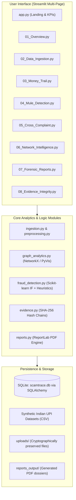

# SCAMTRACE — Development Checklist & Developer Handoff Guide

> **Project Title:** SCAMTRACE — Financial Crime Intelligence & Anti-Money Mule Platform  
> **Problem Statement:** PS-06: Integrated Financial Investigation & Anti-Money Mule Platform  
> **Repository:** [https://github.com/girisudhank8/ScamTrace](https://github.com/girisudhank8/ScamTrace)  
> **Current Version:** `1.0.0-hackathon`  
> **Target Audience:** Incoming Developers, Forensic Data Engineers, Cybercrime Investigators, Evaluators

---

## 📌 Executive Summary

**SCAMTRACE** is an end-to-end, locally deployable financial cybercrime intelligence platform engineered to combat financial fraud, money muling networks, and cyber-enabled laundering. Built specifically for law enforcement agencies, cybercrime investigation cells, and financial intelligence units (FIUs), ScamTrace ingests heterogeneous financial logs (bank statements, UPI exports, payment gateway dumps), standardizes transaction schemas, reconstructs complex multi-hop money trails, isolates mule accounts using explainable heuristics and unsupervised anomaly detection, correlates disparate victim complaints, visualizes transaction graphs, and compiles court-admissible forensic PDF dossiers with cryptographic SHA-256 evidence verification.

---

## 🧭 Current Development Phase & Milestone Status

| Phase | Milestone Description | Status | Progress |
|:-----:|:----------------------|:------:|:--------:|
| **Phase 1** | Foundation, SQLite/SQLAlchemy Schema & Evidence Ingestion Engine | **Completed** | 100% |
| **Phase 2** | Graph Analytics Engine (BFS/DFS Tracing, Cycle Detection, Communities) | **Completed** | 100% |
| **Phase 3** | Explainable Mule Detection (Heuristic Matrix + Isolation Forest) | **Completed** | 100% |
| **Phase 4** | Cross-Complaint Correlation & PyVis Network Visualizer | **Completed** | 100% |
| **Phase 5** | Cryptographic Evidence Integrity (SHA-256) & ReportLab PDF Reporting | **Completed** | 100% |
| **Phase 6** | Unit Test Suite (57/57 tests passing) & Streamlit UI Orchestration | **Completed** | 100% |
| **Phase 7** | **Active Phase: Production Hardening, OCR Fallback & Advanced ML** | **In-Progress** | 35% |
| **Phase 8** | Multi-tenant FIU Deployment & Live WebSocket Banking Simulators | **Backlog** | 0% |

---

## 🏗️ Technical Architecture & Stack



### Stack Components:
- **Core Runtime:** Python 3.11 / 3.12 (standard CPython)
- **Frontend / Dashboard:** Streamlit 1.32+ (Dark Cyberpunk Theme: `#0d1117`, `#1f6feb`, `#2ea8a5`)
- **Data Engineering:** Pandas 2.1+ / 3.x, NumPy 1.26+
- **Graph & Network Science:** NetworkX 3.2+, PyVis 0.3.2 (Interactive HTML canvas embedded via iframe)
- **Machine Learning & Stats:** Scikit-learn 1.4+ (`IsolationForest`), SHAP 0.44+
- **Forensic Reporting:** ReportLab 4.1+ (`SimpleDocTemplate`, `Table`, `Paragraph`, `Drawing`)
- **Document Parsers:** PyMuPDF (`fitz` 1.24+), pdfplumber 0.10+, openpyxl 3.1+
- **Integrity & Security:** Python `hashlib` (SHA-256 byte-stream hashing)
- **Database / ORM:** SQLite 3, SQLAlchemy 2.0+ ORM with direct DBAPI fallback for high-throughput reads
- **Testing:** pytest 8.0+

---

## 📂 Project Directory Structure

```text
scamtrace/
├── app.py                          # Streamlit application entry point & summary dashboard
├── config.py                       # Global paths, risk thresholds, color palette & constants
├── generate_data.py                # Deterministic synthetic Indian banking/UPI generator script
├── requirements.txt                # Pinned production and development dependencies
├── README.md                       # High-level product overview and run commands
├── DEVELOPMENT_CHECKLIST.md        # Comprehensive handoff checklist and developer documentation
├── .env.example                    # Template environment variables
├── .gitignore                      # Git exclusion rules (ignores DB, logs, byte-cache, uploads)
├── assets/
│   └── style.css                   # Custom dark cyber-investigation theme CSS
├── data/
│   ├── synthetic_accounts.csv      # 120 synthetic Indian accounts (Victims, Mules, Legit)
│   ├── synthetic_transactions.csv  # 600 synthetic transactions modeling 8 fraud topologies
│   ├── synthetic_complaints.csv    # 5 cybercrime victim complaints (CMP001 - CMP005)
│   └── README_DATA.md              # Detailed schema specification and scenario documentation
├── modules/
│   ├── __init__.py                 # Python package declaration
│   ├── database.py                 # SQLite ORM models, session manager, and high-speed readers
│   ├── ingestion.py                # Ingestion pipeline for CSV/Excel/PDF, column auto-mapping, deduplication
│   ├── preprocessing.py            # Timestamp normalization, currency cleaning, feature engineering
│   ├── graph_analytics.py          # NetworkX graph builder, BFS/DFS traversal, cycle & community detection
│   ├── fraud_detection.py          # 6-factor mule scoring matrix & Isolation Forest anomaly model
│   ├── evidence.py                 # SHA-256 evidence registration, verification & chain of custody
│   └── reports.py                  # Forensic PDF generator with cryptographic evidence tables
├── pages/
│   ├── 01_Overview.py              # Case telemetry, transaction velocity trends & threat distribution
│   ├── 02_Data_Ingestion.py        # Statement uploader, dynamic field mapping & batch validation
│   ├── 03_Money_Trail.py           # Multi-hop forward/backward money tracing with PyVis visualization
│   ├── 04_Mule_Detection.py        # Configurable heuristic + ML mule detection with feature breakdowns
│   ├── 05_Cross_Complaint.py       # Multi-case nexus correlation & shared intermediary discovery
│   ├── 06_Network_Intelligence.py  # Full topology explorer, Louvain clustering, node centrality metrics
│   ├── 07_Forensic_Reports.py      # Automated PDF forensic investigation report generator
│   └── 08_Evidence_Integrity.py    # Forensic vault: SHA-256 file hashing & anti-tamper verifier
├── tests/
│   ├── __init__.py
│   ├── test_ingestion.py           # Ingestion, validation, deduplication tests (16 tests)
│   ├── test_graph.py               # BFS, shortest path, cycles, communities tests (13 tests)
│   ├── test_fraud.py               # Mule heuristic scoring & Isolation Forest tests (14 tests)
│   └── test_evidence.py            # SHA-256 hashing, verification & tamper detection (14 tests)
├── uploads/                        # Evidence vault for immutable raw uploads (.gitkeep preserved)
└── reports_output/                 # Storage for generated forensic PDF dossiers (.gitkeep preserved)
```

---

## 🗄️ Database Schemas & Data Models

### 1. `transactions`
- `transaction_id` (`String`, Primary Key): e.g., `TXN10001`
- `timestamp` (`DateTime`): Transaction execution timestamp
- `sender_account` (`String`, Indexed): Source account ID
- `receiver_account` (`String`, Indexed): Destination account ID
- `amount` (`Float`): Monetary value in INR (₹)
- `transaction_type` (`String`): `UPI`, `IMPS`, `NEFT`, `RTGS`, `ATM_WITHDRAWAL`
- `payment_reference` (`String`): UPI RRN / UTR reference number
- `complaint_id` (`String`, Nullable): Linked victim complaint reference
- `description` (`Text`): Narration string (e.g., `Cyber scam layer 1 transfer`)

### 2. `accounts`
- `account_id` (`String`, Primary Key): e.g., `ACC_V001`, `ACC_M001`, `ACC_L001`
- `account_holder` (`String`): Fictional entity name
- `account_type` (`String`): `SAVINGS`, `CURRENT`, `WALLET`
- `bank_name` (`String`): Fictional Indian bank entity
- `account_opening_date` (`String`): Opening date for account age calculation
- `risk_status` (`String`): `NORMAL`, `SUSPICIOUS`, `HIGH_RISK`, `FROZEN`
- `upi_id` (`String`): Virtual Payment Address (e.g., `user@okhdfcbank`)
- `phone_number` (`String`): Fictional phone identifier
- `state` (`String`): Geographic jurisdiction

### 3. `complaints`
- `complaint_id` (`String`, Primary Key): e.g., `CMP001`
- `victim_id` (`String`): Fictional victim identifier
- `reported_amount` (`Float`): Total defrauded amount (₹)
- `report_date` (`String`): Date filed on National Cyber Crime Reporting Portal
- `originating_account` (`String`): Victim source debit account
- `description` (`Text`): Modus operandi details (e.g., `Task Fraud`, `Digital Arrest`, `Investment Scam`)
- `status` (`String`): `OPEN`, `UNDER_INVESTIGATION`, `ESCALATED`, `RESOLVED`

### 4. `evidence_records`
- `evidence_id` (`String`, Primary Key): Unique evidence reference (`EVD-XXXXX`)
- `filename` (`String`): Original file name
- `sha256_hash` (`String`): Cryptographic SHA-256 hex digest calculated upon upload
- `upload_timestamp` (`DateTime`): Tamper-evident ingest timestamp
- `file_size` (`Integer`): Size in bytes
- `processing_status` (`String`): `VERIFIED`, `PROCESSED`, `FLAGGED_CORRUPT`
- `original_path` (`String`): Preserved path in immutable vault (`uploads/`)

### 5. `investigation_logs`
- `id` (`Integer`, Primary Key, Autoincrement)
- `timestamp` (`DateTime`): UTC event timestamp
- `action` (`String`): Audit action tag (`INGESTION`, `MULE_FLAGGED`, `REPORT_GENERATED`)
- `details` (`Text`): Granular parameter and outcome details
- `user` (`String`): Investigator account tag

---

## 🎯 Synthetic Fraud Topology Specifications

The included generator (`generate_data.py`) constructs a mathematically deterministic dataset modeling 8 critical cyber-fraud topologies:

1. **5-Hop Layering Chain (Task Scam - `CMP001`):**  
   `ACC_V001` (Victim, ₹4,50,000) ➔ `ACC_M001` (First-hop aggregator) ➔ `ACC_M002` (Layering mule) ➔ `ACC_M007` (Nexus node) ➔ `ACC_M008` (Offshore/P2P cashout).
2. **High-Velocity Aggregator (`ACC_M001`):**  
   Receives bursts of incoming funds from dozens of distinct accounts, maintaining >20 transactions/day and near-zero end-of-day balances.
3. **Rapid Pass-Through Withdrawal (`ACC_M002`):**  
   Incoming deposits are liquidated via ATM withdrawals or immediate NEFT out within <30 minutes (holding time < 1 hr; withdrawal ratio > 0.95).
4. **Circular Layering / Wash Trading (`ACC_M003` 🔄 `ACC_M006`):**  
   Cyclic transfers designed to artificially inflate turnover and obscure source of illicit capital.
5. **Shared Intermediary Nexus (`ACC_M007`):**  
   Common mule servicing both `CMP001` (Task Scam) and `CMP002` (Digital Arrest Scam), revealing organized crime syndicates.
6. **Legitimate Control Population (`ACC_L001` - `ACC_L105`):**  
   105 genuine accounts generating baseline Gaussian salary, utility, and retail payment patterns to prevent false-positive over-fitting.

---

## ✅ Comprehensive Developer Checklist

### 1. Ingestion & Preprocessing Pipeline
- [x] Ingest CSV statement files with arbitrary delimiter handling.
- [x] Ingest Excel workbooks (`.xlsx`, `.xls`) with multi-sheet support via `openpyxl`.
- [x] Ingest bank statement PDFs via `pdfplumber` and `PyMuPDF`.
- [x] Intelligent column auto-mapping engine detecting aliases for Account, Timestamp, Amount, Narration, Reference.
- [x] Ingestion validation: detect negative amounts, malformed timestamps, empty sender/receiver IDs.
- [x] Deduplication engine: hash and match composite key (`timestamp` + `sender` + `receiver` + `amount` + `reference`).
- [x] File size enforcement guardrail (hard limit: 50MB per file).
- [ ] **Pending:** Tesseract OCR fallback integration for scanned image bank passbooks / receipts.
- [ ] **Pending:** Batch ZIP archive ingestion with automatic decompression and multi-account correlation.

### 2. Graph Analytics & Tracing Engine (`modules/graph_analytics.py`)
- [x] Construct directed multi-edge transaction graph `nx.MultiDiGraph` with transaction attributes.
- [x] Forward Multi-Hop BFS/DFS money trail reconstruction with configurable depth (1–10 hops).
- [x] Backward money trail reconstruction (tracing money origins to root victim accounts).
- [x] Minimum amount threshold filtering and datetime window filtering during path traversal.
- [x] Cycle and circular transfer detection (`nx.simple_cycles`) with length thresholding.
- [x] Weakly and strongly connected component decomposition.
- [x] Network centrality computation: In-degree, Out-degree, PageRank, Betweenness centrality.
- [x] Louvain / Greedy Modularity Community Detection for identifying criminal syndicates.
- [ ] **Pending:** Minimum-cut / maximum-flow analysis to detect funneling bottlenecks.
- [ ] **Pending:** Subgraph export to standard formats (Gephi `.gexf`, GraphML, Neo4j Cypher scripts).

### 3. Mule Account Detection & Machine Learning (`modules/fraud_detection.py`)
- [x] Compute 6 granular behavioral features per account:
  - Transaction velocity (peak 24h count)
  - Inflow-to-outflow volume ratio
  - Rapid withdrawal velocity (<2 hour turnaround ratio)
  - Counterparty dispersion ratio (distinct in/out counterparty ratio)
  - Average fund retention / holding duration
  - High-value round-amount burst patterns
- [x] Configurable weighted heuristic scoring formula producing normalized risk scores ($0 - 100$).
- [x] Risk tier categorization: `NORMAL` ($<40$), `MEDIUM` ($40-59$), `HIGH` ($60-79$), `CRITICAL` ($\ge 80$).
- [x] Unsupervised anomaly detection via `IsolationForest` (contamination=0.1, deterministic random state).
- [x] Transparent, human-auditable risk explanations outlining specific red-flag indicators.
- [x] Mandatory forensic disclaimer: *"Heuristic behavioral indicator ONLY — not legal proof of guilt."*
- [ ] **Pending:** Integration of SHAP TreeExplainer waterfall plots in UI for visual feature attribution.
- [ ] **Pending:** Supervised classification model trained on labeled FIU mule typologies.

### 4. Cross-Complaint & Case Nexus Correlation (`modules/cross_complaint.py` & Page 05)
- [x] Multi-case complaint ingestion and selector (`CMP001` - `CMP005`).
- [x] Graph intersection algorithm to isolate shared recipient and intermediary accounts.
- [x] Multi-hop path intersection: identifies common mules even when separated by 2+ hops.
- [x] Automated natural language "Why Connected" narrative explaining criminal nexus.
- [x] Cross-case timeline synchronization chart using Plotly.
- [ ] **Pending:** Levenshtein/Jaro-Winkler fuzzy matching for account holder names and phone numbers.
- [ ] **Pending:** Geographical jurisdiction heat map showing inter-state money movement.

### 5. Forensic Evidence Integrity & PDF Reporting (`modules/evidence.py`, `modules/reports.py`)
- [x] Automatic SHA-256 hash calculation of all original uploaded evidence files upon ingest.
- [x] Immutable raw evidence retention in `uploads/` with UUID prefixing.
- [x] Cryptographic verification tab: compares re-uploaded files against stored registry hashes.
- [x] Visual status indicators: `VERIFIED MATCH` (Green) or `HASH MISMATCH / TAMPER DETECTED` (Red).
- [x] Chain-of-custody audit log tracking every evidence touchpoint, timestamp, and investigator ID.
- [x] End-to-end PDF generation using ReportLab:
  - Official law enforcement cover header & case ID
  - Evidence registry with verified SHA-256 digests
  - Executive summary & total volume breakdown
  - Flagged mule accounts table with transparent score explanations
  - Hop-by-hop money trail table with timestamps & reference numbers
  - Audit trail and mandatory disclaimer footer
- [ ] **Pending:** Dynamic embedding of PyVis network graph snapshot images directly into the PDF.
- [ ] **Pending:** Digital PDF signing using X.509 PKI certificate keys.

### 6. UI / UX Design & Investigative Experience
- [x] Dark navy/charcoal cyber-investigation theme (`assets/style.css`).
- [x] High-contrast responsive metric tiles with Indian Rupee (₹ Lakh/Crore) formatting.
- [x] Interactive PyVis physics-enabled network graphs with node color-coding:
  - Red: Victim Accounts
  - Orange/Crimson: Flagged Mule Accounts
  - Blue: Legitimate Intermediaries
  - Green: Destination / Cashout Endpoints
- [x] One-click "Load Demo Investigation" button with instant session state rehydration.
- [x] Downloadable transaction CSV template button on Data Ingestion page.
- [x] Zero hardcoded numbers — all metrics calculated live from SQLite database.
- [ ] **Pending:** Session-state persistence between browser refreshes without relying on server reload.
- [ ] **Pending:** Multi-language UI support (Hindi, English, regional Indian languages).

### 7. Verification & Quality Assurance (`tests/`)
- [x] 16 tests in `test_ingestion.py` (file formats, column mapping, dedup, error handling).
- [x] 13 tests in `test_graph.py` (BFS forward/backward, cycles, components, shortest path).
- [x] 14 tests in `test_fraud.py` (heuristic risk scoring, thresholding, Isolation Forest).
- [x] 14 tests in `test_evidence.py` (SHA-256 calculation, verification, chain of custody).
- [x] 100% test pass rate: **57 out of 57 unit tests passing**.
- [ ] **Pending:** End-to-end Playwright UI test automation suite for Streamlit.
- [ ] **Pending:** Stress testing pipeline with 1,000,000+ transaction rows.

---

## 🚀 Quickstart & Onboarding Guide for Developers

### 1. Prerequisites
- Python 3.11 or Python 3.12
- Git
- Microsoft Windows, macOS, or Linux

### 2. Environment Setup
```powershell
# Clone the repository
git clone https://github.com/girisudhank8/ScamTrace.git
cd ScamTrace

# Create and activate virtual environment
python -m venv venv
# On Windows PowerShell:
.\venv\Scripts\Activate.ps1
# On macOS/Linux:
# source venv/bin/activate

# Upgrade pip and install dependencies
python -m pip install --upgrade pip
pip install -r requirements.txt
```

### 3. Initialize Database & Seed Synthetic Data
```powershell
# Generate synthetic accounts, transactions, and complaints
python generate_data.py

# Verify database initialization
python -c "from modules.database import DatabaseManager; db = DatabaseManager(); print('Loaded transactions:', len(db.get_transactions()))"
```

### 4. Run the Unit Test Suite
```powershell
python -m pytest tests/ -v --tb=short
```

### 5. Launch ScamTrace Application
```powershell
# Launch Streamlit server
python -m streamlit run app.py --server.headless true --server.port 8501
```
Navigate to `http://localhost:8501` in your browser.

---

## ⚠️ Key Gotchas, Quirks & Architectural Solutions

Incoming developers must review these documented solutions to avoid known pitfalls:

1. **Pandas 3.x vs SQLAlchemy 2.0 Connection Handling:**
   - *Problem:* `pd.read_sql("SELECT ...", self.engine)` raises `UserWarning` or fails with `'Connection' object has no attribute 'cursor'` in modern Pandas versions.
   - *Solution:* In `modules/database.py`, `DatabaseManager._read_sql()` utilizes an explicit standard library `sqlite3.connect(self.db_path)` wrapper for read operations, ensuring 100% stability and sub-millisecond query execution.
2. **PyMuPDF Version Compatibility:**
   - *Problem:* PyMuPDF 2.x introduces breaking changes and namespace collisions with `fitz`.
   - *Solution:* Pinned to `pymupdf==1.24.14` in `requirements.txt`.
3. **Streamlit Component Iframe Rendering for PyVis:**
   - *Problem:* PyVis generates standalone HTML files containing embedded JavaScript that can collide with Streamlit's native DOM.
   - *Solution:* Graphs are written to transient local files (`temp_*.html`) and rendered safely using `streamlit.components.v1.html(..., height=650)`.
4. **PowerShell Command Separation on Windows:**
   - *Problem:* PowerShell treats `&&` as an invalid token on older configurations.
   - *Solution:* Always use `;` as the command delimiter in Windows scripts and automation hooks.
5. **Deterministic Seeding for Hackathon Presentations:**
   - All synthetic accounts (`ACC_V...`, `ACC_M...`, `ACC_L...`) and complaints (`CMP001` - `CMP005`) are fixed-seed deterministic. Never add nondeterministic random number generators to `generate_data.py` without fixing `random.seed(42)` and `np.random.seed(42)`.

---

## 🗺️ Sprint Roadmap for Next Phase Developers

### Priority 1: High (Immediate Sprint)
- [ ] **Dynamic Graph Export in PDF:** Integrate Selenium/Playwright or Kaleido to capture headless screenshots of PyVis network graphs and insert them directly into the ReportLab PDF dossier.
- [ ] **SHAP Explainability Plots:** Add a visual SHAP waterfall plot to Page 04 (Mule Detection) showing individual feature contributions for any selected account.
- [ ] **Automated Freezing Order Generator:** Generate formal 91 CrPC / Section 102 CrPC bank account freeze notice templates populated with mule transaction metrics.

### Priority 2: Medium (Next Sprint)
- [ ] **Tesseract OCR Integration:** Add image preprocessing (OpenCV grayscale, Otsu binarization) to parse photographed UPI transaction receipts and passbook photos.
- [ ] **PostgreSQL / TimescaleDB Adapter:** Add configuration toggle in `config.py` to switch from SQLite to PostgreSQL for concurrent multi-investigator deployments.
- [ ] **FastAPI Headless Backend:** Expose REST endpoints (`/api/v1/trace`, `/api/v1/mules`, `/api/v1/evidence/verify`) so third-party police portals can query the detection engine headlessly.

### Priority 3: Low (Future Enhancements)
- [ ] **Real-time Kafka / WebSocket Ingestion:** Live streaming simulation of banking transactions with instant alert push notifications.
- [ ] **LLM Case Narrative Generator:** Local Llama-3 / Mistral integration to summarize multi-hop money laundering schemes into plain-language police First Information Reports (FIR).

---

## 📜 Legal & Forensic Compliance Disclaimers

1. **Synthetic Data Policy:** All names, account identifiers, bank entities, IFSC codes, UPI handles, and transaction amounts present in the demo files are **strictly synthetic and fictional**. Any resemblance to real individuals, institutions, or accounts is purely coincidental.
2. **Heuristic Risk Attribution:** Risk scores, anomaly flags, and community clusterings output by ScamTrace are **investigative leads and intelligence indicators ONLY**. They do not constitute prima facie legal proof of criminal guilt. All investigative findings require human verification and judicial subpoenas.
3. **Evidence Integrity Preservation:** In compliance with international digital forensics standards (ISO/IEC 27037) and Indian Bharatiya Sakshya Adhiniyam (BSA) / Section 65B requirements, **original evidence files uploaded to the platform are treated as immutable** and preserved with SHA-256 hashes.

---

*Authored by: ScamTrace Core Development Team*  
*Maintained under PS-06 Financial Cybercrime Engineering Initiative*
